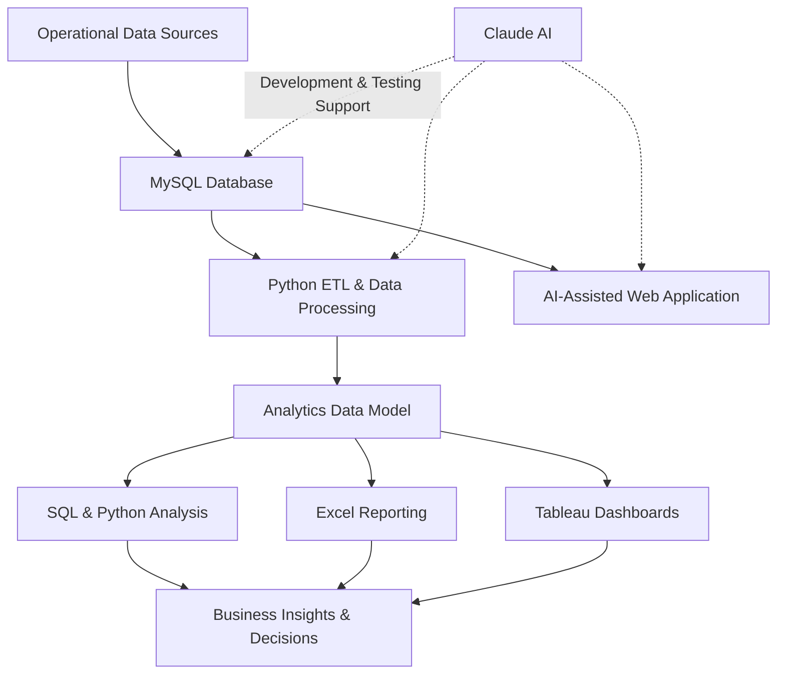

[<- Back to Projects](https://github.com/heesoo-kim97/portfolio-guide/blob/main/README.md)

# Paci Coast — Supply Chain & Logistics Analytics Platform

**An AI-assisted ERP-style operations and supply chain analytics system for a fictional beverage distribution company.**

> How can data analytics, operational systems, and AI-assisted development improve inventory management, warehouse efficiency, and distribution performance?

**Status:** In Progress

---

## Project Overview

Paci Coast Supply Chain & Logistics Analytics is an end-to-end analytics project simulating the operations of a medium-sized beverage distribution company in Southern California.

The project aims to develop a centralized operational and analytics environment that connects procurement, inventory management, customer orders, warehouse fulfillment, and transportation.

Using SQL, Python, Excel, and Tableau, the system will transform operational data into actionable business insights, helping management monitor performance, identify inefficiencies, and make data-driven decisions.

Claude will also be incorporated throughout the development process to assist with system design, application development, data engineering, and testing. AI-generated outputs will be reviewed and validated against defined business requirements.

---

## Company Background

**Paci Coast Beverage Distribution**

| Business Attribute | Description |
| --- | --- |
| Industry | Beverage / Consumer Packaged Goods / Distribution |
| Headquarters | Southern California |
| Business Model | B2B Beverage Distribution |
| Company Size | Medium-sized |
| Primary Customers | Retailers, convenience stores, grocery stores, and food-service businesses |
| Primary User | Operations Manager |

### Business Profile

Paci Coast is a fictional Southern California beverage company that produces, stores, and distributes energy drinks to business customers across the region.

As the company expands its distribution network, management needs better visibility into inventory levels, warehouse performance, order fulfillment, and transportation operations.

The analytics platform is designed to address these challenges through centralized operational data and performance reporting.

| Operational Area | Initial Scope |
| --- | ---: |
| Warehouses | 3 |
| Employees | 75 |
| Product SKUs | 25+ |
| Customers | 15+ |
| Suppliers | 3–5 |
| Vehicles / Carriers | 8+ |
| Historical Data | 12 months |
| Distribution Region | Southern California |

---

## Distribution Network

Paci Coast operates three regional distribution warehouses.

| Warehouse ID | Location | Primary Distribution Area |
| --- | --- | --- |
| WH-01 | Long Beach, CA | LA County / Coastal Region |
| WH-02 | Anaheim, CA | Orange County |
| WH-03 | Ontario, CA | Inland Empire |

Each warehouse maintains its own inventory, storage locations, receiving activities, and fulfillment operations.

The three-location network allows the project to analyze inventory distribution, warehouse efficiency, regional demand, and transportation performance.

---

## Product Portfolio

Paci Coast's product portfolio consists of eight beverage families with different flavors and packaging configurations.

### Product Families

| Product Family | Flavor |
| --- | --- |
| Pacific Original | Original |
| Pacific Zero | Zero Sugar |
| Pacific Citrus | Citrus Blast |
| Pacific Berry | Berry Rush |
| Pacific Tropical | Tropical |
| Pacific Watermelon | Watermelon |
| Pacific Grape | Grape |
| Pacific Peach | Peach |

### Packaging Formats

| Format | Description |
| --- | --- |
| Single Can | Individual 12 oz or 16 oz cans |
| 6-Pack | Six 12 oz cans |
| 12-Pack | Twelve 12 oz cans |
| Variety Pack | Assorted beverage flavors |

Each product and package configuration will receive a unique SKU to support inventory tracking, order processing, and demand analysis.

---

## System Architecture

The platform will connect operational data, database management, data processing, and business intelligence.

### Technology Stack

| Technology | Purpose |
| --- | --- |
| MySQL | Relational database and operational data management |
| SQL | Data extraction, transformation, querying, and analysis |
| Python | Data generation, ETL, data cleaning, and forecasting |
| Pandas | Data manipulation and analysis |
| Excel | Operational reporting and inventory analysis |
| Tableau | Interactive business intelligence dashboards |
| Claude AI | AI-assisted development, data engineering, and testing |
| GitHub | Version control and project documentation |

---

## ERP / WMS Scope

The project will simulate key business processes through interconnected operational modules.

| Module | Purpose |
| --- | --- |
| Dashboard | Monitor company-wide operational KPIs |
| Procurement | Manage suppliers and purchase orders |
| Inventory | Track stock levels by SKU and warehouse |
| Orders | Create and manage customer orders |
| Fulfillment | Simulate picking, packing, and order processing |
| Shipments | Track transportation and delivery activities |
| Exceptions | Identify and investigate operational issues |

---

## Analytics & Business Intelligence

The analytics environment will focus on five primary areas.

| Analytics Module | Key Performance Indicators |
| --- | --- |
| Executive Operations | Revenue, orders, fulfillment rate, inventory value |
| Inventory Analytics | Inventory turnover, stockouts, days of inventory, reorder alerts |
| Warehouse Performance | Picking accuracy, fulfillment time, warehouse utilization |
| Transportation | On-time delivery, delivery time, cost per order |
| Demand Forecasting | Historical demand, product trends, forecast accuracy |

The objective is to move beyond descriptive reporting and identify opportunities for operational improvement.

---

## Key Business Rules

| Rule | Definition |
| --- | --- |
| Low Inventory | Quantity on Hand ≤ Reorder Point |
| Available Inventory | Quantity on Hand − Allocated Quantity |
| Delayed Shipment | Actual Delivery Date > Promised Delivery Date |
| Pending Order | Order created but not fully fulfilled |
| Inventory Allocation | Committing available inventory to customer orders |
| Insufficient Inventory | Available inventory is below the requested order quantity |
| Inventory Movement | Every receipt, shipment, transfer, return, and adjustment is recorded |
| Fulfillment Rate | Percentage of ordered quantities successfully fulfilled |

---

## AI-Assisted Development

Claude will be incorporated as a development assistant throughout the project.

Primary use cases include:

- **System Development:** Assisting with application architecture, database design, and operational workflows.
- **Data Engineering:** Generating Python scripts, SQL queries, and synthetic transactional datasets.
- **Application Development:** Accelerating development of the operational interface and dashboard components.
- **Quality Assurance:** Generating test cases, reviewing business logic, and identifying potential defects.
- **Documentation:** Supporting technical documentation and development records.

AI-generated code and recommendations will be reviewed, tested, and validated before implementation.

The goal is to demonstrate effective AI-assisted development while maintaining ownership of system design, analytical decisions, and business logic.

---

## Project Roadmap

| Phase | Development Focus | Status |
| --- | --- | --- |
| 1 | Business Requirements & System Design | In Progress |
| 2 | Database Architecture & ERD | Planned |
| 3 | Synthetic Data Generation & ETL | Planned |
| 4 | SQL & Python Analytics | Planned |
| 5 | Tableau & Excel Reporting | Planned |
| 6 | AI-Assisted Operational Interface | Planned |
| 7 | Geospatial Analytics & Mapping | Future Expansion |
| 8 | 3D Warehouse Visualization / Digital Twin | Future Expansion |

---

## Future Development

The initial project will prioritize supply chain analytics and operational reporting.

Future development will explore geospatial intelligence and 3D visualization to extend the platform beyond traditional business intelligence.

Potential enhancements include:

- Geographic visualization of warehouses and customer distribution.
- Delivery route and distance analysis.
- Regional demand mapping.
- Warehouse location optimization.
- 3D warehouse layouts and storage visualization.
- Inventory monitoring through a simulated warehouse digital twin.

Potential technologies include ArcGIS, PostGIS, Mapbox, deck.gl, CesiumJS, and Three.js.

---

## Project Objective

Build an end-to-end supply chain analytics platform that demonstrates the application of SQL, Python, Excel, Tableau, database design, and AI-assisted development to realistic business operations.

The project is designed to demonstrate how an analyst can translate operational data into meaningful business insights and actionable recommendations.

